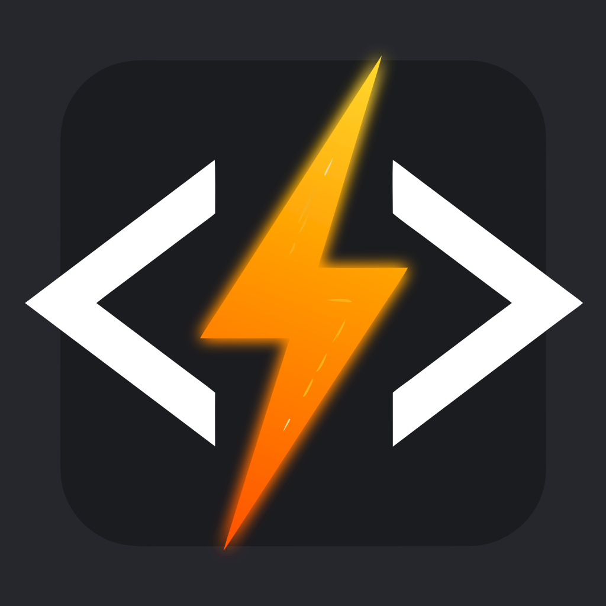

<div align="center">
	
	<h1>QuickSnippets</h1>
	<p><strong>A portable Windows launcher for your text snippets — always one keystroke away.</strong></p>
	<p>
		<a href="LICENSE"></a>
		<a href="https://github.com/ruslan-rv-ua/quick-snippets/releases"></a>
	</p>
	<p>
		🌐 <strong>Read this document in:</strong>
		<a href="README.md">English</a> ·
		<a href="README_UK.md">Українська</a> ·
		<a href="README_DE.md">Deutsch</a>
	</p>
</div>

---

## What is QuickSnippets?

QuickSnippets is a small, portable desktop application that lets you keep a personal library of text snippets and paste any of them into any application within seconds.

Press **Ctrl+Alt+Space** from anywhere on your desktop. The window appears, you type a few letters to find the snippet you need, press **Enter**, and it's in your clipboard. No cloud, no telemetry, no installation required.

Sensitive snippets can be encrypted locally with AES-256-GCM so that only you — with the right password — can access them.

---

## Features

- **Instant access** — global hotkey shows the window from any application
- **Fast search** — fuzzy search filters your snippets as you type
- **Encrypted snippets** — protect sensitive content with a password (AES-256-GCM encryption, keys never leave your device)
- **Fully keyboard-driven** — every action has a shortcut; mouse is optional
- **Screen reader support** — built for NVDA, JAWS, and Windows Narrator from day one
- **Portable** — no installer, no `AppData`, and nothing in the registry unless you turn on "Start with Windows"; the whole app lives in one folder
- **System tray** — stays out of your way when not in use; right-click the tray icon for quick actions
- **Light and dark themes** — switch with a single shortcut or from Settings
- **Three languages** — English, Ukrainian, and German; language auto-detected from your system
- **Single-instance** — launching the app again simply brings the existing window to focus
- **Auto-hide on blur** — the window disappears when you switch away, just like a launcher
- **Auto-type** — press `Shift+Enter` to type a snippet directly into the active window; no clipboard required
- **Snippet sorting** — sort by creation date, modification date, alphabetical order, or last used time; toggle with `Ctrl+Shift+1`–`Ctrl+Shift+4`; preference is saved across restarts

---

## Installation

QuickSnippets is a portable application — no installer needed.

1. Go to the [Releases page](https://github.com/ruslan-rv-ua/quick-snippets/releases).
2. Download the latest `quick-snippets-X.Y.Z-windows-x64.zip`.
3. Extract the ZIP to any folder (e.g. `C:\Tools\QuickSnippets\`).
4. Run `quick-snippets.exe`.

### Installing via Scoop

If you use [Scoop](https://scoop.sh/), you can install QuickSnippets from the author's bucket:

```powershell
scoop bucket add ruslan-rv-ua https://github.com/ruslan-rv-ua/scoop-bucket
scoop install quick-snippets
```

Your snippets database (`snippets.db`) and settings (`settings.json`) are saved in the `quick-snippets-data` folder next to the executable. To move or back up the app, copy the entire folder. If "Start with Windows" is on, turn it off before you move or delete the folder (and on again after a move): Windows keeps the path to the exe in its autostart entry.

With Scoop, that folder is kept across updates in `~\scoop\persist\quick-snippets\quick-snippets-data` — back up that folder instead.

The built-in browser that draws the window (Microsoft Edge WebView2) keeps its cache in a separate `quick-snippets-webview` folder next to the executable (with Scoop, in the folder of each version). None of your data is in it, so it needs no backup; if you delete it while QuickSnippets is closed, the app creates it again.

> **Upgrading from 0.3.3 or earlier** — older versions kept the browser cache in `%LOCALAPPDATA%\com.quicksnippets.app`. This version neither uses nor removes that folder, so an older copy still works. Once you no longer run version 0.3.3 or older, you can delete it.

> **Upgrading from 0.2.1 or earlier** — your encrypted snippets still open. Each one is re-encrypted with stronger settings (PBKDF2-HMAC-SHA256 at 600,000 iterations instead of 100,000) the first time you copy or auto-type it with its password. After that, versions before 0.3.0 can no longer open that snippet (they report "Wrong password"); the data is not damaged, and version 0.3.0 or later opens it again. If you might go back to an older version, back up the `quick-snippets-data` folder before you upgrade.

> **SHA-256 checksum** — a `.sha256` file is attached to every release for verification.

---

## Getting Started

### First launch

On first launch the snippet list is empty. Press **Ctrl+N** (or **Insert**) to create your first snippet.

Give it a short, memorable title — that's what you search by. Paste or type the content. Optionally protect it with a password. Press **Ctrl+Enter** or click **Save**.

### Finding and copying a snippet

1. Press **Ctrl+Alt+Space** from any application.
2. Start typing the snippet title. The list filters in real time.
3. Use **Arrow Up / Down** to move through results.
4. Press **Enter** to copy the selected snippet to the clipboard.
5. Switch to your target application and paste (**Ctrl+V**).

Alternatively, press **Shift+Enter** (instead of **Enter**) to auto-type the snippet directly into the previously active window — without using the clipboard. The window hides, focus returns to the target app, and the text is typed character by character.

The QuickSnippets window hides automatically when you switch away.

### System tray

The application icon lives in the system tray. Right-click it for quick access to **Show**, **New Snippet**, **Settings**, and **Quit**.

---

## Security Model

Your privacy is paramount. QuickSnippets is designed to keep your snippets on your device, encrypted if you choose.

### How Your Data Is Protected

- **AES-256-GCM encryption** — sensitive snippets can be password-protected with military-grade encryption
- **PBKDF2 key derivation** — passwords are stretched with PBKDF2-HMAC-SHA256 at 600,000 iterations (the current OWASP minimum for this algorithm) to resist brute-force attacks
- **Snippets from older versions keep working** — snippets encrypted by version 0.2.1 or earlier (100,000 iterations) still open, and each one is re-encrypted with the stronger setting the first time you copy or auto-type it with its password
- **Unique salt and nonce** — every encryption uses random values, so the same snippet encrypted twice produces different ciphertexts
- **Local storage only** — your database (`snippets.db`) and settings (`settings.json`) live in the `quick-snippets-data` folder next to the executable; no cloud, no telemetry, no sync
- **No AppData, registry only for autostart** — QuickSnippets keeps nothing in AppData directories. It changes the Windows registry only when you turn "Start with Windows" on or off. Turning it on writes the usual autostart entry for your user account and the on/off mark that Task Manager shows for it; turning it off removes both
- **Portable** — copy your entire QuickSnippets folder to back up or migrate everything

### What Is Encrypted

- **Snippet content** — if you choose to protect a snippet with a password, its content is encrypted

### What Is NOT Encrypted

- **Snippet title** — used for searching; stored as plaintext so you can find your snippets
- **Metadata** — creation and modification timestamps are not encrypted
- **Settings** — window geometry, theme preference, language are stored in plaintext

### Memory Safety

- Session keys are held in memory only during decryption
- Plaintext is immediately cleared (zeroized) after use
- No unencrypted data is written to disk

### Important Limitations

- **Timing attacks**: Password verification is not constant-time; use strong passwords
- **Brute-force at UI**: There is no rate limiting on password attempts; only physical security protects against local attacks
- **Device security**: If someone gains access to your device while QuickSnippets is running, they can potentially decrypt snippets by watching memory or clipboard

For complete details on the security model, threat assessment, and responsible disclosure process, see [SECURITY.md](SECURITY.md).

---

## Keyboard Shortcuts

### Global (works from any application)

| Shortcut | Action |
|---|---|
| Ctrl+Alt+Space | Show the QuickSnippets window |

### In the main window

> All letter shortcuts (Ctrl+N, Ctrl+E, Ctrl+D, Ctrl+F, etc.) use the physical key
> position, so they work regardless of the active OS keyboard layout (e.g. Ukrainian).

| Shortcut | Action |
|---|---|
| Arrow Up / Down | Move selection in the snippet list |
| Home / End | Jump to first / last snippet |
| Enter | Copy selected snippet to clipboard |
| Shift+Enter | Auto-type selected snippet into the active application |
| Ctrl+N or Insert | Create new snippet |
| Ctrl+E | Edit selected snippet |
| Ctrl+D or Delete | Delete selected snippet (Delete only when no text follows the cursor in the search box) |
| Ctrl+F or / | Focus the search box |
| Ctrl+, | Open Settings |
| Ctrl+Shift+T | Toggle light / dark theme |
| Ctrl+Shift+1 | Sort by creation date (press again to toggle direction) |
| Ctrl+Shift+2 | Sort by modification date (press again to toggle direction) |
| Ctrl+Shift+3 | Sort alphabetically (press again to toggle direction) |
| Ctrl+Shift+4 | Sort by last used time (press again to toggle direction) |
| Ctrl+Shift+Space | Announce selected snippet (screen reader) |
| F1 | Show the keyboard shortcuts help |
| Escape | Close modal / clear search |
| Alt+F4 | Quit the application |

> In the search box, Delete erases text as in any text field while there is text after the
> cursor or selected text. When no text follows the cursor, Delete asks to delete the selected
> snippet. Right after Delete has erased text, press another key first, for example an arrow key:
> this way, holding Delete down never opens the delete confirmation.

### In forms and modals

| Shortcut | Action |
|---|---|
| Ctrl+Enter | Confirm / save (works in all dialogs including exit and delete confirmation) |
| Escape | Cancel and close the modal |

---

## Settings

Open Settings with **Ctrl+,** or via the tray menu. The settings are in three groups, listed below in the order of the dialog. Theme and language change as soon as you pick them, so you can try them out. **Save** (or **Ctrl+Enter**) keeps all changes; **Cancel**, **Esc** or a click outside the dialog brings back the theme and language you had and drops the other changes. The app version is shown at the bottom of the dialog, and screen readers read it after the dialog title.

### Appearance and language

- **Theme**: Dark or Light.
- **Language**: Same as Windows, English, Українська or Deutsch.

### Startup and closing

- **Start with Windows**: start QuickSnippets when you sign in to Windows. Takes effect the next time you sign in.
- **Start minimized to the tray**: at startup only the tray icon appears. Takes effect at the next start; open the window with **Ctrl+Alt+Space**.
- **Ask before closing the app**: Alt+F4 and the window's close button ask for confirmation first. **Esc** only hides the window, and **Quit** in the tray menu closes the app without asking.

### Auto-type

- **Delay between characters, ms**: from 0 to 1000 (default: 1). `0` is the fastest. If characters go missing or appear out of order in the target app, try 10–50. **Note:** Auto-type does not work into applications running with elevated privileges (Run as administrator).

---

## License

[MIT](LICENSE) — Copyright (c) 2026 Ruslan Iskov
