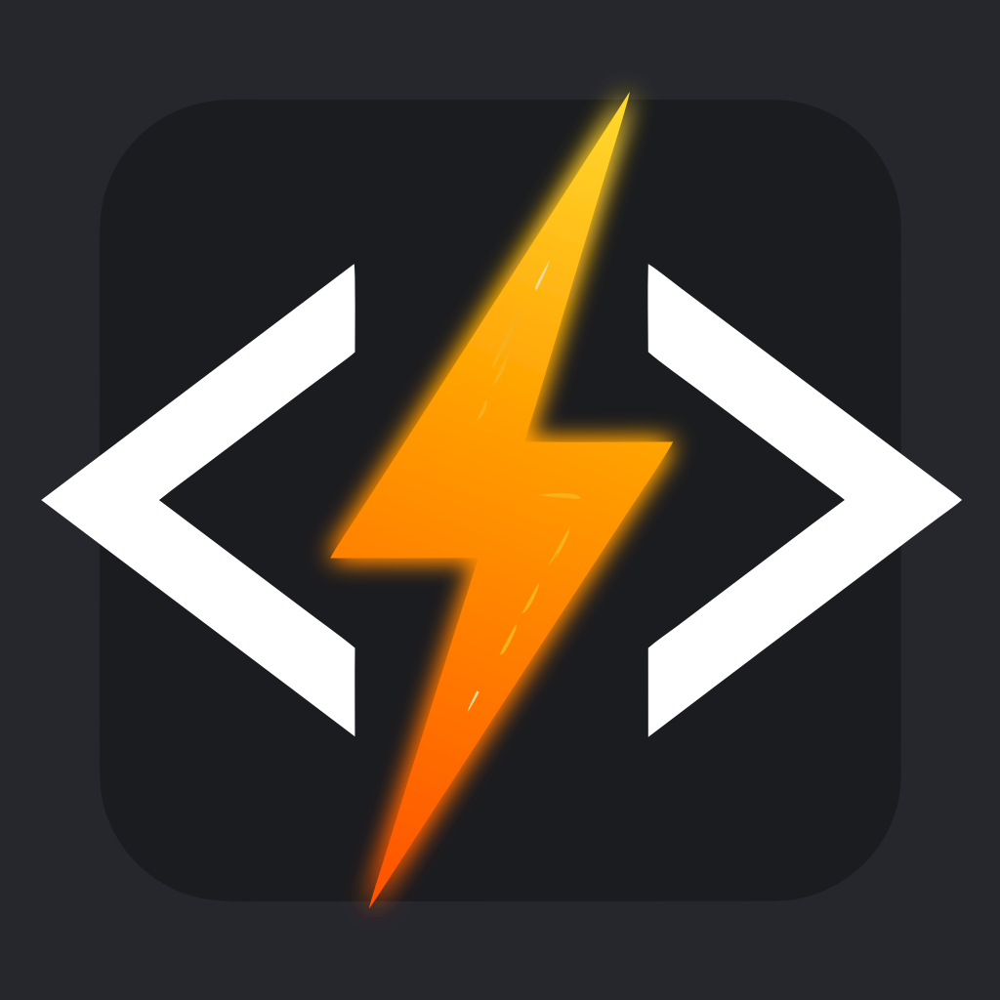

<div align="center">
	
	<h1>QuickSnippets</h1>
	<p><strong>Ein portabler Windows-Launcher für Ihre Textschnipsel — immer nur einen Tastendruck entfernt.</strong></p>
	<p>
		<a href="LICENSE"></a>
		<a href="https://github.com/ruslan-rv-ua/quick-snippets/releases"></a>
	</p>
</div>

---

## Was ist QuickSnippets?

QuickSnippets ist eine kleine, portable Desktop-Anwendung, mit der Sie eine persönliche Bibliothek von Textschnipseln verwalten und diese innerhalb von Sekunden in jede beliebige Anwendung einfügen können.

Drücken Sie **Strg+Alt+Space** von überall auf Ihrem Desktop. Das Fenster erscheint, Sie tippen ein paar Buchstaben ein, um den gewünschten Schnipsel zu finden, drücken **Enter**, und schon befindet er sich in Ihrer Zwischenablage. Keine Cloud, keine Telemetrie, keine Installation erforderlich.

Vertrauliche Schnipsel können lokal mit AES-256-GCM verschlüsselt werden, sodass nur Sie — mit dem richtigen Passwort — Zugriff darauf haben.

---

## Funktionen

- **Sofortiger Zugriff** — globaler Hotkey zeigt das Fenster aus jeder Anwendung
- **Schnelle Suche** — unscharfe Suche (Fuzzy Search) filtert Ihre Schnipsel während der Eingabe
- **Verschlüsselte Schnipsel** — schützen Sie vertrauliche Inhalte mit einem Passwort (AES-256-GCM-Verschlüsselung; der Schlüssel wird mit PBKDF2-HMAC-SHA256 und 600.000 Iterationen aus dem Passwort abgeleitet; Schlüssel verlassen nie Ihr Gerät)
- **Vollständige Tastatursteuerung** — jede Aktion hat ein Tastenkürzel; die Maus ist optional
- **Screenreader-Unterstützung** — entwickelt für NVDA, JAWS und Windows Narrator
- **Portabel** — kein Installer, keine Registry, kein `AppData`; die gesamte App befindet sich in einem Ordner
- **System-Tray** — bleibt im Hintergrund, wenn nicht in Gebrauch; Rechtsklick auf das Tray-Icon für schnelle Aktionen
- **Helles und dunkles Design** — Wechsel mit einem einzigen Tastenkürzel oder über die Einstellungen
- **Drei Sprachen** — Englisch, Ukrainisch und Deutsch; Sprache wird automatisch vom System erkannt
- **Einzelinstanz** — erneutes Starten der App bringt einfach das bestehende Fenster in den Fokus
- **Automatisches Ausblenden** — das Fenster verschwindet, wenn Sie zu einer anderen Anwendung wechseln, genau wie ein Launcher
- **Automatisches Tippen** — drücken Sie `Umschalt+Enter`, um einen Schnipsel direkt in das aktive Fenster einzutippen, ohne die Zwischenablage zu verwenden
- **Schnipsel sortieren** — nach Erstellungsdatum, Änderungsdatum, alphabetisch oder nach letzter Verwendung sortieren; mit `Strg+Umschalt+1`–`Strg+Umschalt+4` umschalten; Einstellung wird zwischen Neustarts gespeichert

---

## Installation

QuickSnippets ist eine portable Anwendung — kein Installer erforderlich.

1. Gehen Sie zur [Releases-Seite](https://github.com/ruslan-rv-ua/quick-snippets/releases).
2. Laden Sie die neueste `quick-snippets-X.Y.Z-windows-x64.zip` herunter.
3. Entpacken Sie die ZIP-Datei in einen beliebigen Ordner (z. B. `C:\Tools\QuickSnippets\`).
4. Starten Sie `quick-snippets.exe`.

### Installation über Scoop

Wenn Sie [Scoop](https://scoop.sh/) verwenden, können Sie QuickSnippets aus dem Bucket des Autors installieren:

```powershell
scoop bucket add ruslan-rv-ua https://github.com/ruslan-rv-ua/scoop-bucket
scoop install quick-snippets
```

Ihre Schnipsel-Datenbank (`snippets.db`) und Einstellungen (`settings.json`) werden im Ordner `quick-snippets-data` neben der ausführbaren Datei gespeichert. Um die App zu verschieben oder zu sichern, kopieren Sie den gesamten Ordner.

Bei Scoop bleibt dieser Ordner über Updates hinweg in `~\scoop\persist\quick-snippets\quick-snippets-data` erhalten — sichern Sie diesen Ordner.

> **Update von Version 0.2.1 oder älter** — Ihre verschlüsselten Schnipsel lassen sich weiterhin öffnen. Jeder von ihnen wird mit stärkeren Parametern (PBKDF2-HMAC-SHA256, 600.000 statt 100.000 Iterationen) neu verschlüsselt, sobald Sie ihn zum ersten Mal mit seinem Passwort kopieren oder automatisch tippen lassen. Danach können Versionen vor 0.3.0 diesen Schnipsel nicht mehr öffnen (sie melden „Falsches Passwort“); die Daten werden dabei nicht beschädigt, und Version 0.3.0 oder neuer öffnet ihn wieder. Falls Sie zu einer älteren Version zurückkehren könnten, sichern Sie vor dem Update den Ordner `quick-snippets-data`.

> **SHA-256-Prüfsumme** — eine `.sha256`-Datei ist jedem Release zur Überprüfung beigefügt.

---

## Erste Schritte

### Erster Start

Beim ersten Start ist die Schnipsel-Liste leer. Drücken Sie **Strg+N** (oder **Einfügen**), um Ihren ersten Schnipsel zu erstellen.

Geben Sie ihm einen kurzen, einprägsamen Titel — danach werden Sie suchen. Fügen Sie den Inhalt ein oder tippen Sie ihn ein. Optional können Sie ihn mit einem Passwort schützen. Drücken Sie **Strg+Enter** oder klicken Sie auf **Speichern**.

### Einen Schnipsel finden und kopieren

1. Drücken Sie **Strg+Alt+Space** aus jeder beliebigen Anwendung.
2. Beginnen Sie, den Titel des Schnipsels einzutippen. Die Liste filtert in Echtzeit.
3. Verwenden Sie **Pfeil hoch / runter**, um durch die Ergebnisse zu navigieren.
4. Drücken Sie **Enter**, um den ausgewählten Schnipsel in die Zwischenablage zu kopieren.
5. Wechseln Sie zu Ihrer Zielanwendung und fügen Sie ihn ein (**Strg+V**).

Alternativ können Sie **Umschalt+Enter** (statt **Enter**) drücken, um den Schnipsel direkt in das zuvor aktive Fenster einzutippen — ohne Zwischenablage. Das Fenster wird ausgeblendet, der Fokus kehrt zur Zielanwendung zurück, und der Text wird Zeichen für Zeichen eingegeben.

Das QuickSnippets-Fenster blendet sich automatisch aus, wenn Sie zu einer anderen Anwendung wechseln.

### System-Tray

Das Anwendungssymbol befindet sich im System-Tray. Klicken Sie mit der rechten Maustaste darauf für schnellen Zugriff auf **Anzeigen**, **Neuer Schnipsel**, **Einstellungen** und **Beenden**.

---

## Tastenkürzel

### Global (funktioniert aus jeder Anwendung)

| Kürzel | Aktion |
|---|---|
| Strg+Alt+Space | QuickSnippets-Fenster anzeigen |

### Im Hauptfenster

> Alle Buchstabenkürzel (Strg+N, Strg+E, Strg+D, Strg+F usw.) verwenden die physische Tastenposition, sodass sie unabhängig vom aktiven Tastaturlayout des Betriebssystems funktionieren.

| Kürzel | Aktion |
|---|---|
| Pfeil hoch / runter | Auswahl in der Schnipsel-Liste bewegen |
| Pos1 / Ende | Zum ersten / letzten Schnipsel springen |
| Enter | Ausgewählten Schnipsel in die Zwischenablage kopieren |
| Umschalt+Enter | Ausgewählten Schnipsel automatisch in die aktive Anwendung tippen |
| Strg+N oder Einfügen | Neuen Schnipsel erstellen |
| Strg+E | Ausgewählten Schnipsel bearbeiten |
| Entf oder Strg+D | Ausgewählten Schnipsel löschen |
| Strg+F oder / | Suchfeld fokussieren |
| Strg+, | Einstellungen öffnen |
| Strg+Umschalt+T | Helles / dunkles Design umschalten |
| Strg+Umschalt+1 | Nach Erstellungsdatum sortieren (erneut drücken für Richtungswechsel) |
| Strg+Umschalt+2 | Nach Änderungsdatum sortieren (erneut drücken für Richtungswechsel) |
| Strg+Umschalt+3 | Alphabetisch sortieren (erneut drücken für Richtungswechsel) |
| Strg+Umschalt+4 | Nach letzter Verwendung sortieren (erneut drücken für Richtungswechsel) |
| Strg+Umschalt+Space | Ausgewählten Schnipsel ansagen (Screenreader) |
| F1 | Hilfe zu den Tastenkürzeln anzeigen |
| Esc | Modal schließen / Suche leeren |
| Alt+F4 | Anwendung beenden |

### In Formularen und Dialogen

| Kürzel | Aktion |
|---|---|
| Strg+Enter | Bestätigen / Speichern (funktioniert in allen Dialogen, einschließlich Beenden- und Löschbestätigung) |
| Esc | Abbrechen und Modal schließen |

---

## Einstellungen

Öffnen Sie die Einstellungen mit **Strg+,** oder über das Tray-Menü. Die Einstellungen sind in drei Gruppen aufgeteilt; unten stehen sie in derselben Reihenfolge wie im Dialog. Design und Sprache ändern sich sofort bei der Auswahl, sodass Sie sie ausprobieren können. **Speichern** (oder **Strg+Enter**) übernimmt alle Änderungen; **Abbrechen**, **Esc** oder ein Klick neben den Dialog stellt das vorherige Design und die vorherige Sprache wieder her und verwirft die übrigen Änderungen. Unten im Dialog steht die Programmversion; Screenreader lesen sie nach dem Dialogtitel vor.

### Darstellung und Sprache

- **Design**: Dunkel oder Hell.
- **Sprache**: Wie in Windows, English, Українська oder Deutsch.

### Start und Beenden

- **Mit Windows starten**: QuickSnippets startet bei der Anmeldung bei Windows. Gilt ab der nächsten Anmeldung.
- **Minimiert im Infobereich starten**: Beim Start ist nur das Symbol im Infobereich zu sehen. Gilt ab dem nächsten Start; das Fenster öffnet sich mit **Strg+Alt+Space**.
- **Vor dem Beenden nachfragen**: Alt+F4 und die Schließen-Schaltfläche des Fensters fragen zuerst nach. **Esc** blendet das Fenster nur aus, und **Beenden** im Tray-Menü schließt die App ohne Nachfrage.

### Automatisch tippen

- **Verzögerung zwischen Zeichen, ms**: von 0 bis 1000 (Standard: 1). `0` ist am schnellsten. Wenn Zeichen im Zielprogramm fehlen oder in falscher Reihenfolge erscheinen, versuchen Sie 10–50. **Hinweis:** Automatisches Tippen funktioniert nicht in Anwendungen mit erhöhten Berechtigungen (Als Administrator ausführen).

---

## Lizenz

[MIT](LICENSE) — Copyright (c) 2026 Ruslan Iskov
