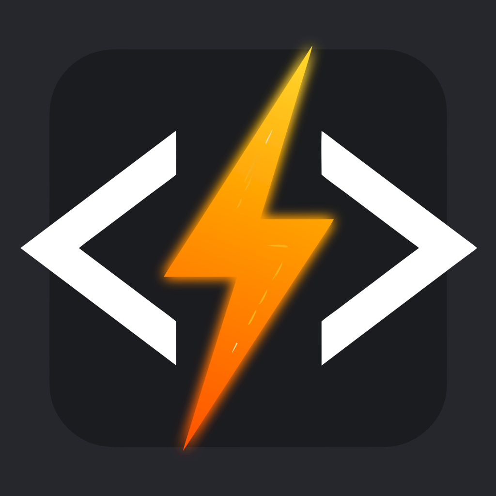

<div align="center">
	
	<h1>QuickSnippets</h1>
	<p><strong>Портативний Windows-лаунчер для ваших текстових сніпетів — завжди під рукою.</strong></p>
	<p>
		<a href="LICENSE"></a>
		<a href="https://github.com/ruslan-rv-ua/quick-snippets/releases"></a>
	</p>
</div>

---

## Що таке QuickSnippets?

QuickSnippets — це невелика портативна програма для робочого столу, яка дозволяє зберігати особисту бібліотеку текстових сніпетів і вставляти будь-який із них у будь-яку програму за лічені секунди.

Натисніть **Ctrl+Alt+Space** з будь-якого місця на робочому столі. З’явиться вікно, введіть кілька літер, щоб знайти потрібний сніпет, натисніть **Enter**, і він уже у вашому буфері обміну. Жодної хмари, жодної телеметрії, встановлення не потрібне.

Чутливі сніпети можна зашифрувати локально за допомогою AES-256-GCM, щоб доступ до них мали лише ви — за допомогою правильного пароля.

---

## Можливості

- **Миттєвий доступ** — глобальна гаряча клавіша показує вікно з будь-якої програми
- **Швидкий пошук** — нечіткий пошук фільтрує ваші сніпети під час введення
- **Зашифровані сніпети** — захистіть чутливий вміст паролем (шифрування AES-256-GCM; ключ виводиться з пароля за PBKDF2-HMAC-SHA256 із 600 000 ітерацій; ключі ніколи не залишають ваш пристрій)
- **Повне керування з клавіатури** — кожна дія має комбінацію клавіш; миша необов’язкова
- **Підтримка екранних читачів** — створено для NVDA, JAWS та Windows Narrator
- **Портативність** — без інсталятора, без `AppData` і без записів у реєстрі, якщо не вмикати «Запускати разом з Windows»; вся програма живе в одній папці
- **Системний трей** — не заважає, коли не використовується; клацніть правою кнопкою миші піктограму в треї для швидких дій
- **Світла та темна теми** — перемикайте однією комбінацією клавіш або через Налаштування
- **Три мови** — англійська, українська та німецька; мова автоматично визначається з вашої системи
- **Один екземпляр** — повторний запуск програми просто фокусує існуюче вікно
- **Автоматичне приховування** — вікно зникає, коли ви перемикаєтесь на інше, як у лаунчері
- **Автодрук** — натисніть `Shift+Enter`, щоб надрукувати сніпет безпосередньо у активне вікно, без буфера обміну
- **Сортування сніпетів** — сортуйте за датою створення, датою зміни, алфавітом або часом останнього використання; перемикайте за допомогою `Ctrl+Shift+1`–`Ctrl+Shift+4`; налаштування зберігається між перезапусками

---

## Встановлення

QuickSnippets — це портативна програма, інсталятор не потрібен.

1. Перейдіть на [сторінку релізів](https://github.com/ruslan-rv-ua/quick-snippets/releases).
2. Завантажте останній `quick-snippets-X.Y.Z-windows-x64.zip`.
3. Розпакуйте ZIP у будь-яку папку (наприклад, `C:\Tools\QuickSnippets\`).
4. Запустіть `quick-snippets.exe`.

### Встановлення через Scoop

Якщо ви використовуєте [Scoop](https://scoop.sh/), ви можете встановити QuickSnippets з бакета автора:

```powershell
scoop bucket add ruslan-rv-ua https://github.com/ruslan-rv-ua/scoop-bucket
scoop install quick-snippets
```

Ваша база даних сніпетів (`snippets.db`) і налаштування (`settings.json`) зберігаються в папці `quick-snippets-data` поряд з виконуваним файлом. Щоб перемістити або створити резервну копію програми, скопіюйте всю папку. Якщо увімкнено «Запускати разом з Windows», вимкніть це перед тим, як перемістити чи видалити папку (а після переміщення ввімкніть знову): Windows зберігає шлях до exe у своєму записі автозапуску. Окрім цього запису й позначки «увімкнено» для Диспетчера завдань, програма нічого не пише в реєстр, а змінює їх лише тоді, коли ви вмикаєте чи вимикаєте цей параметр. Вимкнення прибирає і запис, і позначку.

Під Scoop ця папка зберігається між оновленнями в `~\scoop\persist\quick-snippets\quick-snippets-data` — резервну копію робіть саме з неї.

Вбудований браузер, який малює вікно (Microsoft Edge WebView2), тримає свій кеш в окремій папці `quick-snippets-webview` поряд з виконуваним файлом (під Scoop — у папці кожної версії). Ваших даних у ній немає, тож резервна копія їй не потрібна; якщо видалити її, коли QuickSnippets закрито, програма створить її знову.

> **Оновлення з версії 0.3.3 або старішої** — старіші версії тримали кеш браузера в `%LOCALAPPDATA%\com.quicksnippets.app`. Ця версія цю папку не використовує й не видаляє, тож старіша копія працює й далі. Коли ви вже не запускаєте версію 0.3.3 чи старішу, цю папку можна видалити.

> **Оновлення з версії 0.2.1 або старішої** — ваші зашифровані сніпети відкриваються й надалі. Кожен із них перешифровується з надійнішими параметрами (PBKDF2-HMAC-SHA256, 600 000 ітерацій замість 100 000), коли ви вперше копіюєте або автодрукуєте його зі своїм паролем. Після цього версії до 0.3.0 цей сніпет уже не відкриють (вони показують «Невірний пароль»); дані при цьому не пошкоджуються, і версія 0.3.0 або новіша відкриє його знову. Якщо ви можете повернутися на старішу версію, перед оновленням зробіть резервну копію папки `quick-snippets-data`.

> **Контрольна сума SHA-256** — файл `.sha256` додається до кожного релізу для перевірки.

---

## Початок роботи

### Перший запуск

При першому запуску список сніпетів порожній. Натисніть **Ctrl+N** (або **Insert**), щоб створити свій перший сніпет.

Дайте йому коротку, запам'ятовувану назву — за нею ви будете шукати. Вставте або введіть вміст. За бажанням захистіть його паролем. Натисніть **Ctrl+Enter** або клацніть **Зберегти**.

### Пошук і копіювання сніпета

1. Натисніть **Ctrl+Alt+Space** з будь-якої програми.
2. Почніть вводити назву сніпета. Список фільтрується в реальному часі.
3. Використовуйте **Стрілку Вгору / Вниз** для переміщення по результатах.
4. Натисніть **Enter**, щоб скопіювати вибраний сніпет у буфер обміну.
5. Перейдіть до цільової програми та вставте (**Ctrl+V**).

Або натисніть **Shift+Enter** (замість **Enter**), щоб автоматично надрукувати сніпет у попередньо активне вікно — без буфера обміну. Вікно ховається, фокус повертається до цільової програми, і текст вводиться посимвольно.

Вікно QuickSnippets автоматично приховується, коли ви перемикаєтесь на іншу програму.

### Системний трей

Піктограма програми знаходиться в системному треї. Клацніть її правою кнопкою миші для швидкого доступу до **Показати**, **Новий сніпет**, **Налаштування** та **Вихід**.

---

## Гарячі клавіші

### Глобальні (працюють з будь-якої програми)

| Комбінація | Дія |
|---|---|
| Ctrl+Alt+Space | Показати вікно QuickSnippets |

### У головному вікні

> Усі літерні скорочення (Ctrl+N, Ctrl+E, Ctrl+D, Ctrl+F тощо) використовують фізичне розташування клавіш, тому вони працюють незалежно від активної розкладки клавіатури ОС (наприклад, української).

| Комбінація | Дія |
|---|---|
| Стрілка Вгору / Вниз | Переміщення виділення у списку сніпетів |
| Home / End | Перехід до першого / останнього сніпета |
| Enter | Копіювати вибраний сніпет у буфер обміну |
| Shift+Enter | Авто-надрукувати вибраний сніпет у активну програму |
| Ctrl+N або Insert | Створити новий сніпет |
| Ctrl+E | Редагувати вибраний сніпет |
| Ctrl+D або Delete | Видалити вибраний сніпет (Delete — лише коли в полі пошуку після курсора немає тексту) |
| Ctrl+F або / | Фокус на полі пошуку |
| Ctrl+, | Відкрити Налаштування |
| Ctrl+Shift+T | Перемкнути світлу / темну тему |
| Ctrl+Shift+1 | Сортувати за датою створення (повторне натискання змінює напрямок) |
| Ctrl+Shift+2 | Сортувати за датою зміни (повторне натискання змінює напрямок) |
| Ctrl+Shift+3 | Сортувати за алфавітом (повторне натискання змінює напрямок) |
| Ctrl+Shift+4 | Сортувати за часом останнього використання (повторне натискання змінює напрямок) |
| Ctrl+Shift+Space | Оголосити вибраний сніпет (екранний читач) |
| F1 | Показати довідку з гарячих клавіш |
| Escape | Закрити модальне вікно / очистити пошук |
| Alt+F4 | Вийти з програми |

> У полі пошуку Delete стирає текст, як у будь-якому текстовому полі, поки після курсора є текст
> або текст виділено. Коли після курсора тексту немає, Delete питає, чи видалити вибраний сніпет.
> Одразу після того, як Delete стер текст, спершу натисніть іншу клавішу, наприклад стрілку:
> так затиснутий Delete ніколи не відкриває підтвердження видалення.

### У формах та модальних вікнах

| Комбінація | Дія |
|---|---|
| Ctrl+Enter | Підтвердити / зберегти (працює у всіх діалогах, включаючи підтвердження виходу та видалення) |
| Escape | Скасувати та закрити модальне вікно |

---

## Налаштування

Відкрийте Налаштування клавішами **Ctrl+,** або через меню трею. Налаштування поділено на три групи; нижче вони йдуть у тому ж порядку, що й у діалозі. Тема й мова змінюються одразу після вибору, тож їх можна спробувати. **Зберегти** (або **Ctrl+Enter**) зберігає всі зміни; **Скасувати**, **Esc** або клацання поза діалогом повертають попередні тему й мову і відкидають інші зміни. Унизу діалогу видно версію програми, а екранний диктор читає її після назви діалогу.

### Вигляд і мова

- **Тема**: Темна або Світла.
- **Мова**: Як у Windows, English, Українська або Deutsch.

### Запуск і закриття

- **Запускати разом з Windows**: QuickSnippets запускається, коли ви входите в Windows. Діє з наступного входу.
- **Запускати згорнутим у трей**: під час запуску видно лише значок у треї. Діє з наступного запуску; вікно відкривається клавішами **Ctrl+Alt+Space**.
- **Питати перед закриттям програми**: Alt+F4 і кнопка закриття вікна спершу питають підтвердження. **Esc** лише ховає вікно, а **Вихід** у меню трею закриває програму без питання.

### Автодрук

- **Затримка між символами, мс**: від 0 до 1000 (за замовчуванням: 1). `0` — найшвидше. Якщо в іншій програмі символи губляться або вводяться не в тому порядку, спробуйте 10–50. **Примітка:** автодрук не працює у програмах з підвищеними правами (запуск від імені адміністратора).

---

## Ліцензія

[MIT](LICENSE) — Авторське право (c) 2026 Руслан Іськов
